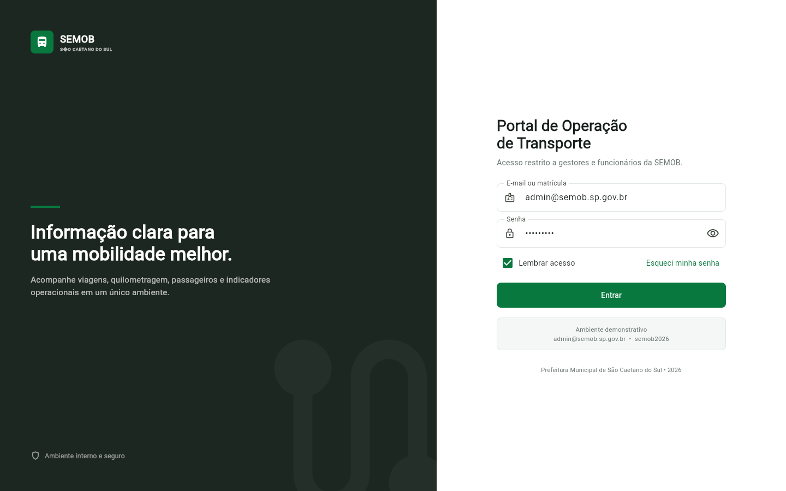
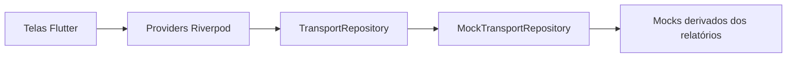
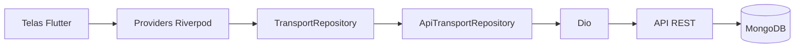
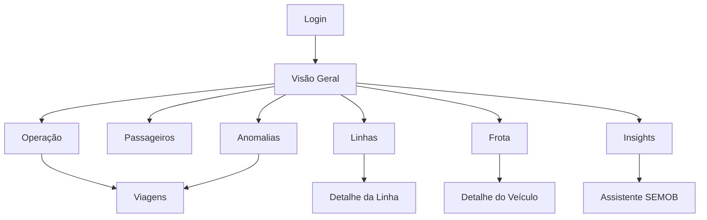

<div align="center">

# 🚌 Portal de Operação de Transporte

### SEMOB — São Caetano do Sul

Frontend multiplataforma para acompanhamento da operação do transporte público municipal.

[](https://flutter.dev/)
[](https://dart.dev/)
[](https://riverpod.dev/)
[](https://pub.dev/packages/go_router)
[](#qualidade-e-testes)
[](#status-do-projeto)

**Web · Windows · Android · Desktop · Tablet · Mobile**

</div>

---



## Sobre o projeto

O **Portal de Operação de Transporte** é uma aplicação interna criada para gestores, analistas, operadores e administradores da Secretaria de Mobilidade Urbana de São Caetano do Sul.

O sistema transforma relatórios operacionais extensos em uma experiência visual, responsiva e navegável. Ele reúne indicadores de viagens, quilometragem, passageiros, linhas, veículos, dados financeiros e ocorrências em um único ambiente.

Esta etapa do projeto prioriza o **frontend, a experiência do usuário e a arquitetura**. Os dados exibidos são mocks derivados dos arquivos reais fornecidos pela SEMOB. Ainda não existem backend, MongoDB, autenticação institucional ou inteligência artificial conectados.

## Sumário

- [Principais funcionalidades](#principais-funcionalidades)
- [Dados usados no protótipo](#dados-usados-no-protótipo)
- [Tecnologias](#tecnologias)
- [Arquitetura](#arquitetura)
- [Como executar localmente](#como-executar-localmente)
- [Credenciais de demonstração](#credenciais-de-demonstração)
- [Execução por plataforma](#execução-por-plataforma)
- [Rotas e fluxo de navegação](#rotas-e-fluxo-de-navegação)
- [Responsividade](#responsividade)
- [Qualidade e testes](#qualidade-e-testes)
- [Build de produção](#build-de-produção)
- [Solução de problemas](#solução-de-problemas)
- [Limitações atuais](#limitações-atuais)
- [Roadmap](#roadmap)
- [Equipe](#equipe)

## Principais funcionalidades

### Autenticação interna

- login por e-mail ou matrícula;
- mostrar e ocultar senha;
- opção de lembrar acesso;
- recuperação de senha informativa;
- estados de carregamento, campos obrigatórios e credenciais inválidas;
- tratamento visual de sessão expirada;
- proteção das rotas internas;
- logout pelo menu de perfil.

### Visão Geral

- passageiros totais, pagantes e não pagantes;
- viagens programadas e realizadas;
- taxa de realização;
- km total e km produtivo;
- comparação com o período anterior;
- passageiros por dia;
- viagens programadas versus realizadas;
- quilometragem produtiva, improdutiva e total;
- distribuição de passageiros;
- desempenho consolidado por linha.

### Operação e viagens

- veículos utilizados por dia;
- cumprimento da programação;
- dias com diferença entre viagens programadas e realizadas;
- busca por linha, veículo ou atividade;
- filtros por status;
- ordenação e paginação;
- visualização em tabela no desktop;
- visualização em cards no mobile;
- ações visuais de exportação.

### Passageiros

- catraca;
- antecipados;
- não pagantes;
- total diário;
- composição empilhada por dia;
- evolução no período;
- percentual de não pagantes;
- identificação do dia de maior demanda.

### Linhas e frota

- listagem e busca de linhas;
- viagens, km total e desempenho;
- detalhe individual da linha;
- listagem de prefixos identificados nas viagens;
- linhas atendidas por veículo;
- viagens e quilometragem por prefixo;
- detalhe individual do veículo.

### Financeiro

- créditos transferidos para cartões;
- saldo final do sistema;
- evolução temporal;
- maior transferência registrada;
- identificação explícita de campos financeiros ainda indisponíveis.

### Anomalias e insights

- viagens programadas não realizadas;
- viagens não iniciadas;
- viagens não terminadas;
- diferenças diárias de operação;
- níveis crítico, atenção e informativo;
- filtros e ação de investigação;
- insights descritivos comparando julho e agosto de 2026.

### Assistente SEMOB

- interface pronta para futura integração com IA;
- contexto visual dos filtros selecionados;
- sugestões de perguntas;
- respostas demonstrativas com texto, KPI, gráfico e ranking;
- ações para ver dados, abrir análise, aplicar filtro e exportar;
- experiência adaptada para desktop e mobile.

### Administração e apoio

- relatórios por domínio;
- ações visuais para PDF e CSV;
- usuários e níveis de acesso;
- busca e filtros de usuários;
- modal de novo usuário;
- perfil do funcionário;
- permissões resumidas;
- preferências e central de ajuda.

## Dados usados no protótipo

Foram analisados **44 relatórios HTML** contendo dados mensais e quinzenais de julho, agosto e setembro de 2026, além da documentação acadêmica do produto.

### Indicadores consolidados

| Indicador | Julho/2026 | Agosto/2026 |
|---|---:|---:|
| Viagens programadas | 36.387 | 35.050 |
| Viagens realizadas | 36.330 | 34.994 |
| Km produtivo | 248.321,3 | 261.886,8 |
| Km improdutivo | 14.425,5 | 13.807,7 |
| Km total | 262.746,8 | 275.694,5 |
| Passageiros totais | 489.653 | 1.050.248 |

### Campos encontrados nas fontes

| Domínio | Campos utilizados |
|---|---|
| Operação | Data, dia da semana, veículos, máximo por faixa, viagens programadas e realizadas, diferenças e quilometragem |
| Viagens | Linha, prefixo, atividade, sentido, faixa horária, início, fim e quilometragem |
| Passageiros | Catraca, antecipados, não pagantes e total de passageiros |
| Linhas | Código, número de viagens e km total |
| Frota | Prefixos derivados dos registros de viagens |
| Financeiro | Créditos transferidos para cartões e saldo final |
| Ocorrências | Viagens não realizadas, não iniciadas e não terminadas |

> [!IMPORTANT]
> O relatório de passageiros informa que seus valores são provisórios e atualizados conforme o sistema de bilhetagem. A mesma ressalva aparece na interface.

> [!NOTE]
> Passageiros por linha, tarifa média e receita tarifária não são apresentados como dados reais porque esses relacionamentos não estão disponíveis nas fontes usadas pelo frontend.

## Tecnologias

| Tecnologia | Responsabilidade |
|---|---|
| Flutter | Interface Web, Windows e Android |
| Dart | Linguagem principal |
| Riverpod | Estado global, autenticação, filtros e carregamento dos repositórios |
| go_router | Navegação declarativa e proteção de rotas |
| Dio | Cliente HTTP preparado para a API futura |
| fl_chart | Gráficos de linha, barras, barras empilhadas e distribuição |
| intl | Formatação numérica e monetária em `pt_BR` |
| Flutter Test | Testes de widgets e responsividade |

## Arquitetura

O frontend foi organizado por funcionalidades, com separação entre interface, modelos, repositórios, serviços, mocks e componentes compartilhados.

```text
lib/
├── core/
│   ├── responsive/       # breakpoints e detecção de layout
│   ├── theme/            # cores, tema e espaçamento
│   └── utils/            # formatação de números e moeda
├── features/
│   ├── auth/
│   ├── dashboard/
│   ├── operation/
│   ├── trips/
│   ├── passengers/
│   ├── lines/
│   ├── fleet/
│   ├── financial/
│   ├── anomalies/
│   ├── insights/
│   ├── ai_assistant/
│   ├── reports/
│   ├── users/
│   ├── settings/
│   └── help/
├── mocks/                # dados derivados dos relatórios
├── models/               # modelos do domínio
├── repositories/         # contrato e repositório mock
├── router/               # rotas e proteção de sessão
├── services/             # cliente Dio
└── shared/               # providers, shell e widgets reutilizáveis
```

### Fluxo atual



### Fluxo planejado



O contrato `TransportRepository` permite substituir os mocks por requisições reais sem reescrever as telas.

## Como executar localmente

### 1. Pré-requisitos

Instale:

- [Git](https://git-scm.com/downloads);
- [Flutter SDK](https://docs.flutter.dev/get-started/install) no canal estável;
- Dart compatível com `^3.12.2` — já incluído no Flutter;
- Google Chrome ou Microsoft Edge para execução Web;
- Visual Studio com **Desktop development with C++** para Windows;
- Android Studio e Android SDK para Android.

Confirme a instalação:

```powershell
flutter --version
flutter doctor -v
flutter devices
```

O `flutter doctor -v` mostra exatamente quais dependências da sua máquina ainda precisam ser configuradas.

### 2. Clonar o repositório

```powershell
git clone https://github.com/OmarFLK/Projeto_Integrador_SEMOB.git
cd Projeto_Integrador_SEMOB
```

Se o repositório já estiver na sua máquina:

```powershell
cd "C:\Users\omars\Documents\Obsidian Vault\ProjetoIntegrador\Projeto_Integrador_SEMOB"
git pull origin main
```

### 3. Instalar as dependências

```powershell
flutter pub get
```

### 4. Verificar os dispositivos disponíveis

```powershell
flutter devices
```

Exemplo de saída esperada:

```text
Chrome (web)
Windows (desktop)
Android SDK built for x86 (mobile)
```

### 5. Executar no navegador

```powershell
flutter run -d chrome
```

O Flutter abrirá uma janela do Chrome automaticamente.

Caso prefira iniciar um servidor Web sem abertura automática:

```powershell
flutter run -d web-server --web-hostname 127.0.0.1 --web-port 8080
```

Depois acesse:

```text
http://127.0.0.1:8080
```

### 6. Comandos durante a execução

Com o `flutter run` ativo no terminal:

| Tecla | Ação |
|---|---|
| `r` | Hot reload — aplica alterações mantendo o estado |
| `R` | Hot restart — reinicia o estado da aplicação |
| `h` | Exibe os comandos disponíveis |
| `q` | Encerra a aplicação |

## Credenciais de demonstração

```text
Usuário: admin@semob.sp.gov.br
Senha:   semob2026
```

O login é local e demonstrativo. Não utilize credenciais reais nesta versão.

## Execução por plataforma

### Web — Chrome

```powershell
flutter run -d chrome
```

### Web — servidor local

```powershell
flutter run -d web-server --web-port 8080
```

### Windows Desktop

Primeiro habilite o suporte, caso necessário:

```powershell
flutter config --enable-windows-desktop
flutter devices
```

Depois execute:

```powershell
flutter run -d windows
```

### Android

1. Abra o Android Studio.
2. Inicie um emulador pelo **Device Manager** ou conecte um aparelho com depuração USB.
3. Confirme o dispositivo com `flutter devices`.
4. Execute usando o identificador exibido.

```powershell
flutter run -d <id-do-dispositivo>
```

Exemplo:

```powershell
flutter run -d emulator-5554
```

## Rotas e fluxo de navegação

| Rota | Tela | Objetivo |
|---|---|---|
| `/login` | Login | Autenticação interna demonstrativa |
| `/dashboard` | Visão Geral | KPIs e gráficos consolidados |
| `/operation` | Operação | Cumprimento, frota diária e km |
| `/trips` | Viagens | Registros detalhados e exceções |
| `/passengers` | Passageiros | Demanda e categorias de bilhetagem |
| `/lines` | Linhas | Desempenho por linha |
| `/lines/:code` | Detalhe da Linha | Informações da linha selecionada |
| `/fleet` | Frota | Prefixos e uso dos veículos |
| `/fleet/:prefix` | Detalhe do Veículo | Histórico do prefixo selecionado |
| `/financial` | Financeiro | Créditos transferidos e saldo |
| `/anomalies` | Anomalias | Central de ocorrências |
| `/insights` | Insights | Leituras derivadas dos indicadores |
| `/assistant` | Assistente SEMOB | Experiência de IA mockada |
| `/reports` | Relatórios | Visualizações e exportações |
| `/users` | Usuários e Acessos | Administração visual de usuários |
| `/profile` | Meu Perfil | Dados e permissões do funcionário |
| `/settings` | Configurações | Preferências da aplicação |
| `/help` | Ajuda | Orientações de uso |



## Responsividade

O projeto não usa apenas um desktop reduzido. Cada faixa possui navegação e comportamento próprios.

| Faixa | Largura | Comportamento |
|---|---:|---|
| Mobile | `< 720 px` | Bottom navigation, menu “Mais”, filtros em bottom sheet, cards empilhados e listas no lugar de tabelas |
| Tablet | `720–1179 px` | Rail lateral recolhido, grids de duas colunas e tabelas adaptadas |
| Desktop | `≥ 1180 px` | Sidebar completa, topbar, painéis amplos e acesso flutuante ao assistente |

O login possui breakpoint próprio em `980 px`, evitando que o formulário seja comprimido ao lado do painel institucional.

## Qualidade e testes

### Análise estática

```powershell
flutter analyze
```

Resultado da última validação:

```text
No issues found!
```

### Testes automatizados

```powershell
flutter test
```

Coberturas atuais:

- renderização do login;
- credenciais demonstrativas;
- navegação após autenticação;
- grade responsiva de indicadores;
- dashboard sem overflow em `390 × 844`;
- dashboard sem overflow em `900 × 1100`;
- dashboard sem overflow em `1440 × 900`.

Resultado da última execução:

```text
6 tests passed
```

### Relatório de cobertura

```powershell
flutter test --coverage
```

O arquivo será criado em:

```text
coverage/lcov.info
```

## Build de produção

### Web

```powershell
flutter build web --release
```

Saída:

```text
build/web/
```

Para testar o build localmente:

```powershell
cd build/web
python -m http.server 8080
```

Acesse `http://127.0.0.1:8080`.

### Windows

```powershell
flutter build windows --release
```

Saída principal:

```text
build/windows/x64/runner/Release/
```

### Android APK

```powershell
flutter build apk --release
```

Saída:

```text
build/app/outputs/flutter-apk/app-release.apk
```

### Android App Bundle

```powershell
flutter build appbundle --release
```

Saída:

```text
build/app/outputs/bundle/release/app-release.aab
```

## Solução de problemas

### `flutter` não é reconhecido

Adicione a pasta `flutter/bin` ao `PATH` do sistema e abra um novo terminal.

```powershell
flutter --version
```

### Chrome não aparece em `flutter devices`

Verifique se o Chrome está instalado. Como alternativa, use:

```powershell
flutter run -d web-server --web-port 8080
```

### Windows não aparece como dispositivo

```powershell
flutter config --enable-windows-desktop
flutter doctor -v
```

Confirme também a instalação do Visual Studio com a carga **Desktop development with C++**.

### Dependências inconsistentes

```powershell
flutter clean
flutter pub get
flutter run -d chrome
```

### Porta ocupada no servidor Web

Escolha outra porta:

```powershell
flutter run -d web-server --web-port 8081
```

### Emulador Android não encontrado

- abra o Device Manager do Android Studio;
- inicie um emulador;
- aceite as licenças pendentes;
- confira novamente os dispositivos.

```powershell
flutter doctor --android-licenses
flutter devices
```

## Limitações atuais

- autenticação apenas demonstrativa;
- repositório de dados local, sem API real;
- filtros globais preparados para integração completa com consultas no backend;
- exportações PDF e CSV apenas visuais;
- Assistente SEMOB com respostas mockadas;
- usuários e permissões sem persistência;
- passageiros sem associação por linha na fonte atual;
- receita tarifária e tarifa média indisponíveis;
- marca SEMOB desenhada temporariamente em código até o recebimento do logo oficial.

## Status do projeto

| Área | Status |
|---|---|
| Design system | ✅ Implementado |
| Navegação | ✅ Implementada |
| Responsividade | ✅ Mobile, tablet e desktop |
| Dashboard | ✅ Funcional com dados mockados |
| Telas operacionais | ✅ Implementadas |
| Testes essenciais | ✅ Aprovados |
| Build Web | ✅ Validado |
| Backend/API | ⏳ Próxima etapa |
| MongoDB | ⏳ Próxima etapa |
| Autenticação real | ⏳ Próxima etapa |
| IA real | ⏳ Próxima etapa |

## Roadmap

- [x] Criar a base Flutter multiplataforma.
- [x] Implementar design system institucional.
- [x] Criar autenticação mockada e rotas protegidas.
- [x] Construir dashboard e módulos operacionais.
- [x] Adaptar os layouts para desktop, tablet e mobile.
- [x] Adicionar testes essenciais e validação de overflow.
- [x] Preparar Dio e contrato de repositório.
- [ ] Adicionar o logo oficial da SEMOB.
- [ ] Implementar a API REST.
- [ ] Criar o `ApiTransportRepository`.
- [ ] Integrar MongoDB Atlas.
- [ ] Implementar autenticação e autorização reais.
- [ ] Conectar filtros e paginação ao backend.
- [ ] Gerar PDF e CSV reais.
- [ ] Integrar o Assistente SEMOB a um serviço de IA.
- [ ] Publicar o frontend Web.
- [ ] Criar pipeline de CI/CD.

## Documentação complementar

Leia [DOCUMENTACAO_FRONTEND.md](DOCUMENTACAO_FRONTEND.md) para consultar o mapeamento detalhado das fontes, decisões de integridade dos dados, arquitetura, estados da interface e próximos passos técnicos.

## Equipe

| Integrante | RA | Papel registrado no projeto |
|---|---|---|
| Omar Abdalah Halada Saliba | 25.11749-0 | Desenvolvedor |
| Bernardo Cassiano Putini da Costa | 25.11766-4 | Desenvolvedor |
| Andrey Salomão Almeida | 25.11761-5 | Product Owner |
| Enzo Pizzoni de Sette | 25.00467-2 | Scrum Master |
| Lucas Hideaki Tomita | 25.00969-7 | Desenvolvedor |

Projeto Integrador — **TTI206 Desenvolvimento Multiplataformas · 2026**.

---

<div align="center">

Desenvolvido para apoiar uma operação de transporte público mais clara, ágil e orientada por dados.

</div>
