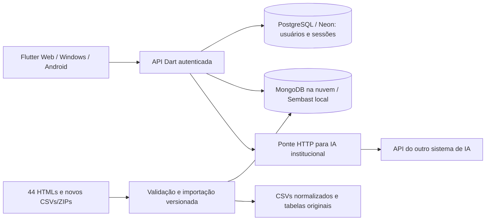

# Portal de Operação de Transporte — SEMOB

Aplicação Flutter para consultar operação, viagens, passageiros, linhas, frota e financeiro da SEMOB de São Caetano do Sul. Backend Dart/Shelf com autenticação e **dois bancos separados: relacional para usuários e não relacional para transporte**.


## Arquitetura implementada



- Login real por e-mail ou matrícula, senhas com PBKDF2, sessões revogáveis, perfis e administração de contas.
- Indicadores calculados sobre o período selecionado; cobertura parcial explicitada, sem o antigo crescimento mensal fixo de passageiros.
- Viagens com busca, filtros, exceções e paginação remota; detalhes de linhas e veículos consultam seus próprios registros.
- Relatórios com exportação real em CSV/PDF, modelos de CSV e importação autorizada pela interface.
- Preferência de modo compacto persistida por usuário.
- Ponte para a IA externa preparada. **A URL/contrato do sistema existente ainda precisam ser informados para a conexão de produção.** Não há respostas simuladas.

## Executar localmente

Requer Flutter/Dart compatíveis com Dart `^3.12.2`. Ambiente validado: Flutter 3.47.7 / Dart 3.13.5. No Windows, o script encontra o SDK no PATH, em `FLUTTER_ROOT` ou em `~/development/flutter`.

No Windows, o Flutter pode exigir o Modo de Desenvolvedor para criar os links dos plugins durante `pub get`, especialmente para suporte desktop. As dependências foram resolvidas e o build web foi validado nesta máquina; a configuração desse modo no Windows não foi alterada automaticamente.

```powershell
$env:DATABASE_URL = Read-Host 'URL PostgreSQL de desenvolvimento (local ou Neon)'
powershell -ExecutionPolicy Bypass -File .\scripts\run_local.ps1
```

O script aplica/verifica as migrações e pede a senha inicial somente se o banco estiver vazio. O e-mail inicial padrão é `admin@semob.local`; pode ser alterado por `SEMOB_ADMIN_EMAIL`. **Não existe mais senha de demonstração fixa.** A API abre na porta 8081 e o frontend na 8080. Se configurar `DIRECT_DATABASE_URL`, ela deve apontar ao mesmo banco de `DATABASE_URL`.

Execução manual, em dois terminais:

```powershell
# Terminal 1 — configure DATABASE_URL e SEMOB_ADMIN_PASSWORD antes do primeiro início.
cd backend
dart pub get --enforce-lockfile
dart run bin/server.dart
```

```powershell
# Terminal 2 — raiz do projeto
flutter pub get --enforce-lockfile
flutter run -d edge --web-port 8080 --dart-define=API_BASE_URL=http://127.0.0.1:8081/api/v1/
```

O gerenciamento usa PostgreSQL via `DATABASE_URL`, local ou Neon. O transporte usa `backend/data/transport.sembast` em desenvolvimento ou MongoDB via `SEMOB_MONGODB_URI` (obrigatório em produção). O antigo `semob.db` não é usado nem apagado. A API local pode importar o ZIP privado se ele estiver disponível. Para produção, importe os dados diretamente no Atlas antes de subir o Render: bancos e relatórios ficam fora do Git e da imagem Docker. Para transferir usuários de `users.sqlite`, consulte o migrador em [TUTORIAL_DEPLOY.md](TUTORIAL_DEPLOY.md), antes de iniciar a API nova.

## Converter os HTMLs para CSV

Coloque o ZIP dos HTMLs em `backend/data/semob_transport_reports.zip` na sua máquina. Toda a pasta de dados é privada e não é publicada no GitHub.

```powershell
powershell -ExecutionPolicy Bypass -File .\scripts\import_data.ps1
```

Saída em `backend/data/exports/`: dez CSVs de domínio, registro das fontes, `manifest.json` e **55 CSVs das tabelas originais** em `raw/`. A importação canônica preserva 91.108 registros de viagens. Os arquivos gerados e bancos são locais e estão no `.gitignore`; podem ser reproduzidos pelo comando. Na interface, Relatórios e dados também oferece CSV normalizado do período e modelos para novos lotes.

CSV não substitui o banco: serve para intercâmbio/exportação; o banco mantém documentos, versões, origem e consultas. O banco de documentos armazena também os CSVs brutos em partes, preservando as tabelas que não prevaleceram no consolidado.

## Qualidade dos dados

- Julho: operação de 31 dias, mas passageiros apenas de 15 a 31/07.
- Agosto: 31 dias de operação/passageiros; 36.751 registros detalhados e 57 prefixos distintos.
- Setembro: dados disponíveis até 14/09.
- Passageiros por linha/veículo/horário não existem na fonte atual. Créditos transferidos não equivalem a receita tarifária.
- As contagens de atividades detalhadas, viagens normais e exceções têm semânticas diferentes. A interface identifica essa distinção.
- Prioridade por registro: fonte do mês do fato; mensal sobre quinzenal; correção explícita em CSV prevalece. Em empates entre novos lotes, prevalece a importação mais recente.

## Testes e build

```powershell
flutter analyze --no-pub
flutter test --no-pub
flutter build web --release --dart-define=API_BASE_URL=https://SEU-DOMINIO/api/v1/
cd backend
dart analyze
# Configure SEMOB_TEST_DATABASE_URL com PostgreSQL de testes e permissão CREATEDB.
dart test
dart build cli --target bin/server.dart
```

Os testes de identidade exigem `SEMOB_TEST_DATABASE_URL` e criam/removem bancos temporários `semob_test_*`. O teste MongoDB executa quando `SEMOB_TEST_MONGODB_URI` está configurada. Nunca use credenciais de produção nos testes. O CI fornece PostgreSQL/MongoDB, usa dados sintéticos e verifica que arquivos privados não foram versionados. O teste completo dos 44 HTMLs exige o ZIP privado local (ou `SEMOB_TEST_DATA_ARCHIVE`); só esse teste fica ignorado quando a fonte não existe.

## Deploy e integração com IA

Siga [TUTORIAL_DEPLOY.md](TUTORIAL_DEPLOY.md) para publicar **Neon + Atlas + Render + Vercel**, transferir o SQLite e preparar o proxy do frontend. [IMPLEMENTACAO_E_DEPLOY.md](IMPLEMENTACAO_E_DEPLOY.md) detalha API, permissões, CSVs e integração com IA. [`.env.example`](.env.example) documenta as variáveis. Somente o Compose lê `.env` automaticamente; Dart/Flutter usam variáveis do processo.

```powershell
# Preencha os segredos de .env antes de executar. Nenhum recurso externo é contratado.
docker compose up --build
```

A API usa PostgreSQL/Neon para usuários e MongoDB para transporte, sem disco persistente no Render. O Compose fornece os dois bancos localmente. Configure `SEMOB_AI_URL` com a rota exata da IA existente; a comunicação é backend → backend. O Neon da IA permanece separado do banco SEMOB.

## Equipe

| Integrante | RA | Papel registrado no projeto |
|---|---|---|
| Omar Abdalah Halada Saliba | 25.11749-0 | Desenvolvedor |
| Bernardo Cassiano Putini da Costa | 25.11766-4 | Desenvolvedor |
| Andrey Salomão Almeida | 25.11761-5 | Product Owner |
| Enzo Pizzoni de Sette | 25.00467-2 | Scrum Master |
| Lucas Hideaki Tomita | 25.00969-7 | Desenvolvedor |

Projeto Integrador — TTI206 Desenvolvimento Multiplataformas · 2026.
